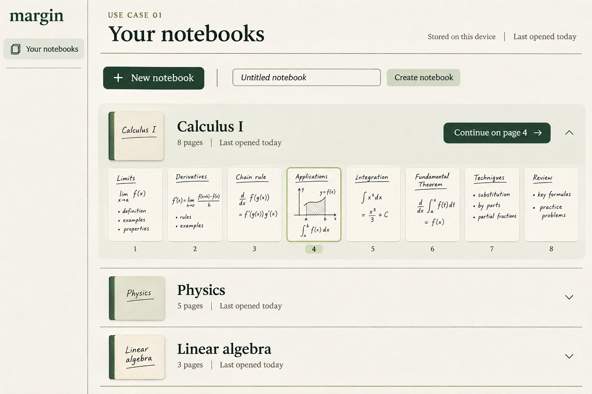
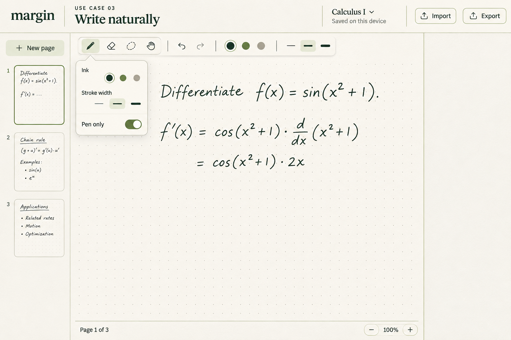
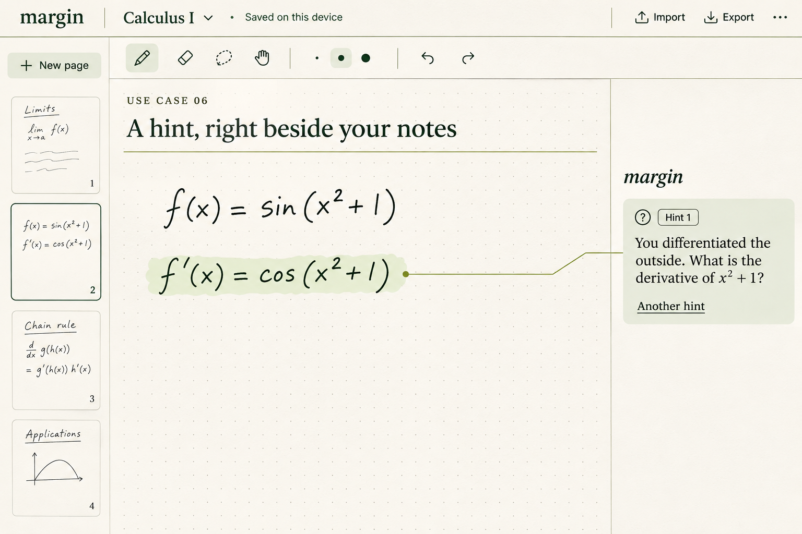
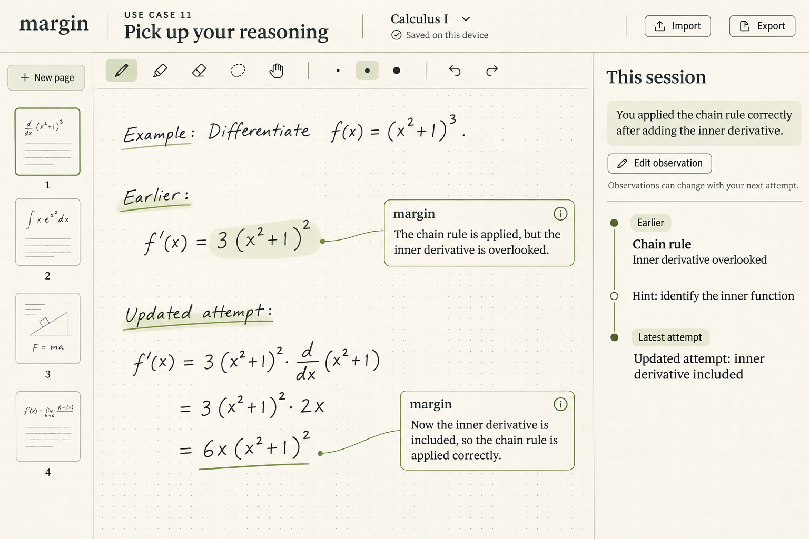
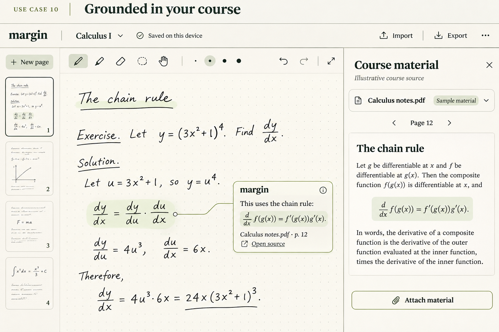

# margin — Feature principali per l'implementazione

Write. Think. Understand.
AI guidance, right beside your notes.

Questo documento restringe la proposta a cinque feature. I mockup sono concept dell'esperienza prevista e contengono materiale didattico illustrativo. La cartella contiene anche esplorazioni aggiuntive; solo le cinque immagini richiamate qui costituiscono il riferimento di questa proposta.

## 1. Quaderni, pagine e importazione
Creare e riaprire un quaderno, aggiungere pagine e importare PDF o immagini.
Interfaccia: libreria iniziale essenziale; nell'editor, miniature delle pagine a sinistra e azione Import nella barra superiore.
Criterio: aprire un PDF multipagina, annotarlo e ritrovare ordine e contenuto dopo il ricaricamento nello stesso browser.
Riferimento: R01–R02.

## 2. Scrittura sul foglio
Scrivere con la penna, cancellare, annullare/ripristinare, spostare e ingrandire la pagina.
Interfaccia: foglio dominante e toolbar compatta; i pannelli secondari si possono chiudere.
Criterio: completare uno svolgimento su iPad; zoom e spostamento mantengono allineati consegna, scrittura e annotazioni.
Riferimento: R03–R04.

## 3. Aiuto contestuale e indizi progressivi
Selezionare un passaggio, oppure l'intera pagina, e chiedere un indizio. Un aiuto successivo approfondisce senza completare automaticamente l'esercizio.
Interfaccia: selezione leggera sul foglio, annotazione nel margine con collegamento al passaggio, azione Another hint. Gli indizi si possono nascondere o rimuovere lasciando intatta la scrittura.
Criterio: errore intenzionale → indizio pertinente ancorato alla selezione → studente che riprende il lavoro.
Riferimento: R05–R08.

## 4. Nuovo tentativo e memoria della sessione
Dopo una modifica, chiedere una nuova verifica. Registrare difficoltà osservata, aiuto dato ed esito aggiornato.
Interfaccia: Check this step e una sezione This session richiudibile; distinguere chiaramente suggerimenti precedenti e feedback sul tentativo attuale.
Criterio: correzione dello studente → nuova lettura del foglio → aggiornamento dell'osservazione; riconoscere anche metodi alternativi validi.
Riferimento: R09, R11.

## 5. Dispense e fonti del corso
Associare materiale didattico al quaderno e aprire la fonte di un suggerimento quando il riferimento è verificato.
Interfaccia: pannello Course material con documenti allegati; nella nota, documento e pagina cliccabili.
Criterio: aprire dal suggerimento la pagina del materiale realmente usata. Il documento mostrato nel mockup è illustrativo.
Riferimento: R10.

## Comportamenti trasversali
- Salvataggio locale automatico, stato visibile, esportazione della consegna e dello svolgimento.
- Grafia ambigua o dati mancanti: una domanda mirata prima di valutare.
- Richiesta AI in corso o fallita: scrittura e salvataggio continuano.
- Risposta a una versione precedente: chiedere di rivalutare il lavoro attuale.
- Invio della pagina su richiesta esplicita di aiuto; cancellazione dei dati controllati dall'app.
- UI in inglese; stile carta avorio, verde inchiostro e salvia; font serif per identità/titoli, sans serif per controlli.

## Ordine di implementazione
1. Consolidare quaderni, importazione e scrittura.
2. Collegare il tutor reale e completare il ciclo indizio → modifica → verifica.
3. Aggiungere la memoria della sessione e il collegamento alle dispense.

Demo centrale: importa un esercizio → scrivi → seleziona un passaggio → chiedi un indizio → correggi → verifica di nuovo.

Immagini generate con il tool integrato image_gen. Il prompt comune e i prompt dei singoli mockup sono in prompts.json.

